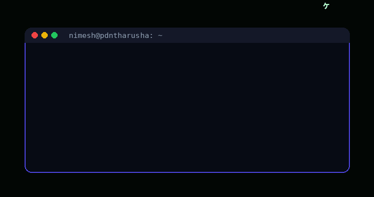

<!-- ═══════════════ HEADER ═══════════════ -->
<p align="center">
  
</p>

<p align="center">
  <a href="https://nimeshtharusha.infinityfree.me/">
    
  </a>
</p>

<p align="center">
  <a href="https://nimeshtharusha.infinityfree.me/"></a>
  <a href="https://linkedin.com/in/nimesh-tharusha"></a>
  <a href="mailto:hello@nimeshtharusha.dev"></a>
  
</p>

<br/>

<p align="center">
  
</p>

---

## 🧑‍💻 About Me

```js
const nimesh = {
  role:      "Full Stack Developer",
  education: "BSc (Hons) Software Engineering — 4th year",
  location:  "Sri Lanka 🇱🇰",
  focus:     ["Full stack web apps", "UI/UX design", "Landing pages", "Android"],
  building:  "AkuruOne — a Sinhala · Singlish · English keyboard for Android",
  status:    "Available for freelance work 🚀",
};
```

- 🌐 Freelance full stack developer since **2023** — custom web apps, landing pages and API integrations
- 🏢 Former **Software Engineering Intern** — reusable component libraries, database design, code reviews, sprints
- 🎨 From **Figma** wireframes to production code
- 📫 Reach me at **hello@nimeshtharusha.dev**

---

## 🛠️ Tech Stack

<p align="center">
  <b>Frontend</b><br/><br/>
  
</p>

<p align="center">
  <b>Backend & Databases</b><br/><br/>
  
</p>

<p align="center">
  <b>Mobile, Languages & Tools</b><br/><br/>
  
</p>

---

## 🚀 Featured Work

<table>
  <tr>
    <td width="50%" valign="top">

### ⌨️ AkuruOne Keyboard
An Android keyboard for Sri Lanka — Singlish → Sinhala, a smart Sinhala **vowel bar**, **103 themes** with live previews, a theme editor and on-device clipboard history.

`Java` `Android IME` `Material 3`

</td>
    <td width="50%" valign="top">

### 🔧 [Garage Management System 2.0](https://github.com/pdntharusha/Garage-management-System-2.0)
Manages vehicle and customer registrations, vehicle details and bill payments through a Windows Forms interface.

`C#` `ASP.NET` `Windows Forms`

</td>
  </tr>
  <tr>
    <td width="50%" valign="top">

### 🏥 [Hospital Management System](https://github.com/pdntharusha/Hospital-Management-System-2023)
Manages patients, medical history, doctors and appointments, backed by an MS SQL database.

`C#` `ASP.NET` `MS SQL`

</td>
    <td width="50%" valign="top">

### ✅ [Task Tracker](https://github.com/pdntharusha/Task-Tracker)
An app for tracking tasks.

</td>
  </tr>
</table>

---

## 📊 GitHub Stats

<p align="center">
  
  
</p>

<p align="center">
  
</p>

<p align="center">
  
</p>

---

<p align="center">
  
</p>

<p align="center"><i>“Fast, clean and accessible — that's the goal every time.”</i></p>
